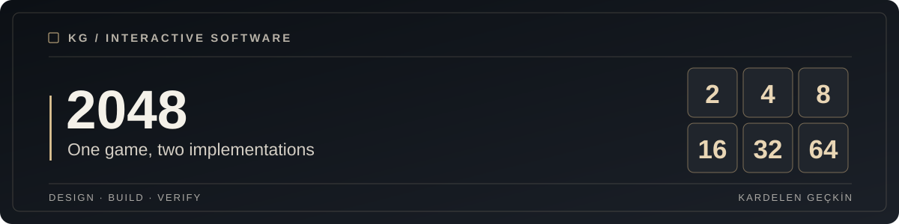
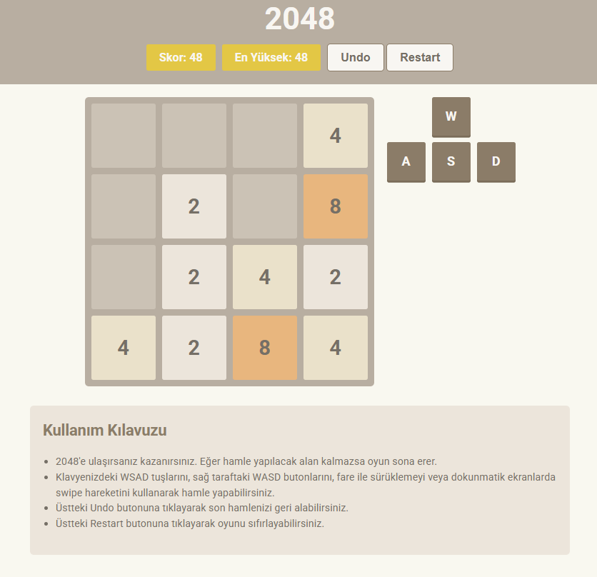

<div align="center">



**The classic 2048 puzzle, implemented twice to explore both server and browser state.**

[Flask setup](#getting-started) · [JavaScript version](jsCodeOnly/index.html) · [Screenshot](images/gameplay.png)

</div>

## Overview

This repository contains two independent implementations of 2048. The Python
version uses Flask sessions to maintain the board and score. The browser
version uses HTML, CSS and JavaScript without a Python server.

Players can use the keyboard, on-screen buttons and supported gestures.



## What it includes

* A four by four game board with valid movement and tile combination rules.
* Score tracking, undo and restart controls.
* A Flask backend and HTML template version.
* A standalone browser implementation in `jsCodeOnly/`.

## Getting started

**Prerequisite:** Python 3.11 or later for the Flask version.

```bash
git clone https://github.com/kgeckin/game2048.git
cd game2048
python -m venv .venv
```

Activate the virtual environment, then:

```bash
python -m pip install -r requirements.txt
python app.py
```

The Flask game runs locally. Optionally set `SECRET_KEY` in an ignored
`.env` file so browser sessions survive process restarts. Without it,
the local development process generates a temporary random session key.

To use the **JavaScript version**, open
[jsCodeOnly/index.html](jsCodeOnly/index.html) in a browser. It does
not require Python or Flask.

An earlier [hosted demo](https://web.itu.edu.tr/~geckin19/) is linked for
reference. Its present availability has not been independently checked.

## Repository structure

```text
game2048/
├── app.py             # Flask routing and game session state
├── logic.py           # Game board movement and score logic
├── templates/         # Flask HTML interface
├── jsCodeOnly/        # Standalone JavaScript implementation
├── images/            # Gameplay screenshot
├── tests/             # Logic and Flask route tests
├── docs/assets/       # Shared editorial cover
├── requirements.txt
└── requirements-dev.txt
```

## Validation

```bash
python -m pip install -r requirements-dev.txt
python -m pytest -q tests
```

The unit tests cover movement, merge scoring and basic Flask route behavior.
They do not verify every mobile browser interaction.

## Architecture & decisions

The Flask app manages each game's state in a signed session cookie. Board
transformations are implemented in `logic.py` and are tested independently.
The JavaScript version keeps its game logic in the browser.

## Security & limitations

* Debug mode is disabled by default and Flask binds to the loopback interface.
* A random key replaces the previous hardcoded session secret.
* State-changing undo and restart actions now use POST.
* Flask's development server is not intended for production hosting.
* Game state is maintained in the browser session and does not represent a
  tamper-resistant score leaderboard.

## License

No repository license file is currently present. Establish reuse rights
before redistributing or relicensing this code.
